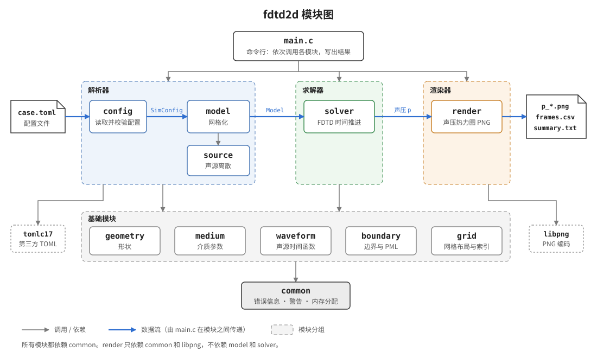

# fdtd2d API 文档总览

fdtd2d 是一个 C11 编写的二维声场 FDTD 仿真工具：无黏性理想流体、静止介质、线性声学。本目录按模块逐一说明公开 API。各模块的头文件（`headers/*.h`）是接口契约；本文档与头文件不一致时以头文件为准，并应当修正文档。

使用方法见 [使用手册](../manual.md)，数值方法见 [原理说明](../theory.md)。

## 模块分层



| 模块 | 头文件 / 实现 | 作用 | 文档 |
|---|---|---|---|
| common | `headers/common.h`、`src/common.c` | 错误信息、警告、内存分配辅助 | [common.md](common.md) |
| geometry | `headers/geometry.h`、`src/geometry.c` | 与网格无关的二维形状 | [geometry.md](geometry.md) |
| grid | `headers/grid.h` | 交错网格布局与索引换算（仅头文件） | [grid.md](grid.md) |
| medium | `headers/medium.h`、`src/medium.c` | 介质参数与介质表 | [medium.md](medium.md) |
| waveform | `headers/waveform.h`、`src/waveform.c` | 声源时间函数（v1：简谐） | [waveform.md](waveform.md) |
| boundary | `headers/boundary.h`、`src/boundary.c` | 外边界类型与 PML 参数 | [boundary.md](boundary.md) |
| config | `headers/config.h`、`src/config.c` | 解析器第一层：TOML → `SimConfig` | [config.md](config.md) |
| source | `headers/source.h`、`src/source.c` | 声源空间离散 | [source.md](source.md) |
| model | `headers/model.h`、`src/model.c` | 解析器第二层：`SimConfig` → 网格模型 | [model.md](model.md) |
| solver | `headers/solver.h`、`src/solver.c` | FDTD 时间推进 | [solver.md](solver.md) |
| render | `headers/render.h`、`src/render.c` | 热力图 PNG 输出 | [render.md](render.md) |

依赖只能自上而下：基础模块互不依赖（只依赖 common），renderer 不依赖 model，也不依赖 solver。

## 全局约定

**单位**：全部使用 SI 单位，包括 m、s、Pa、kg/m³、m/s、Hz、rad。二维问题中的“体积”量均按单位深度（每米深度）计。

**错误处理**：可能失败的函数返回 `int`，`0` 表示成功，`-1` 表示失败。失败时把单行可读信息写入调用方传入的 `FdtdError *err`。`err` 可以为 `NULL`，此时只返回错误码。外层调用用 `fdtd_error_prefix()` 补充上下文，最终信息形如 `source[1]: point (5, 1) is outside the physical domain`。

**警告**：可继续运行、但用户应当知道的情况（如每波长网格点数偏少），通过 `fdtd_warn()` 输出到 stderr，并计数。

**内存所有权**：
- 结构体中标注 *owned* 的指针由该结构体负责释放，并配有对应的 `*_free()` 函数。
- 所有 `*_free()` 都可以安全地作用于全零结构体，也可以重复调用。
- 构建函数（如 `model_build`）失败时保证输出结构体为全零，调用方无需清理。
- 标注 *borrowed* 的指针不归该结构体所有，被指对象的生命周期必须更长。

**数组布局**：二维场一律按行优先存储，x 方向变化最快。单元 `(i, j)` 的下标为 `j*nx + i`。详见 [grid.md](grid.md)。

**线程安全**：v1 为单线程。`common` 中的警告计数和警告输出流是进程级全局状态。

## 构建

```fish
set -e LD_LIBRARY_PATH; set -e PYTHONHOME; set -e PYTHONPATH
cmake -S . -B build -DFDTD2D_WERROR=ON
cmake --build build -j
ctest --test-dir build --output-on-failure
```

CMake 选项：

| 选项 | 默认 | 作用 |
|---|---|---|
| `FDTD2D_BUILD_TESTS` | ON | 构建单元测试与验证测试 |
| `FDTD2D_WERROR` | OFF | 把编译警告视为错误 |
| `FDTD2D_SANITIZE` | OFF | 启用 AddressSanitizer 与 UBSan |

链接目标：`fdtd2d_core`（静态库，包含全部模块）、`fdtd2d`（命令行程序）、`tomlc17`（第三方 TOML 解析库，见 `third_party/tomlc17/VERSION.txt`）。
